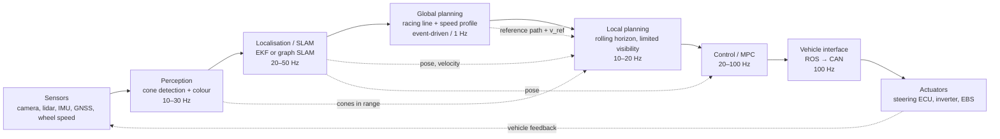

# 2.3 Planning & Control

This module is the design for the **main race stack** used by
`fake run/fixed_path_driver.py`: how the global and local planners produce a
reference, how the MPC tracks it, and how the result becomes CAN signals. The
current driver is the pure-pursuit + Stanley baseline; the MPC in §6 is the
next step.

> Audience: planning/control and integration engineers who will implement or
> replace the baseline. Units are SI unless stated. Frames follow ROS REP-103
> (`map`: x forward/east, y left/north, z up; yaw positive counter-clockwise).

---

## 0. How to run the current main stack

Inside the dev container:

```bash
# starts eufs_sim2 if needed, /set_mission {4} + /go, then the race stack
bash "fake run/start_race.sh" --detach --foxglove
```

`--detach` keeps the stack running after the terminal closes (log:
`/tmp/race_mode.log`). Stop it with:

```bash
bash "fake run/start_race.sh" --stop
```

`start_race.sh` starts the scenery, trail recorder, OpenCV camera, command mux
and fixed-path driver. The explicit version is:

```bash
python3 "fake run/track_scenery.py"
python3 "fake run/trail_recorder.py"
python3 "fake run/track_camera.py"
python3 "fake run/cmd_mux.py"        # race mode is the default
python3 "fake run/fixed_path_driver.py"
```

Custom track from the editor:

```bash
bash "fake run/start_race.sh" --detach \
  --track "fake run/track_editor.csv" \
  --centerline "fake run/centerline_editor.csv"
```

The script loads the track into `eufs_sim2`, resets the car to the start, and
passes the same files to every node. See `fake run/README.md` for the editor.

The visual topics are `/track/scenery` (road/barriers/cones/trees/red
centreline), `/race/trail` (green previous trail, reset each lap),
`/centerline_markers`, `/race/camera` and `/race/camera_info`. See §8.2.

`fixed_path_driver.py` publishes `/race/cmd`. The mux forwards only the selected
source to `/cmd`:

```text
/race/cmd (fixed_path_driver.py) ─┐
                                  ├──> /cmd (eufs_sim2)
/fly/cmd  (fly_bridge, fun mode) ─┘
```

The **fruit-fly side-project is a separate fun mode**. It must never fight the
race controller: start the mux with `-p mode:=fly`, run `fly_bridge` (which
publishes `/fly/cmd`), and do **not** run `fixed_path_driver.py`. The default
mux mode is `race`, so an accidental fly start cannot move the car. See
`fruitfly/README.md` for the fly setup.

For the old standalone driver behaviour (no mux):
`python3 "fake run/fixed_path_driver.py" --ros-args -p cmd_topic:=/cmd`.

---

## 1. End-to-end flow



In the EUFS simulator the left-hand side is replaced: perception is emulated
(`/camera/cones`, `/cones`) and localisation is ground truth (`/odom`). The
right-hand side is `AckermannDriveStamped` on `/cmd`; the real car replaces that
with CAN frames.

### 1.1 Rates and latency budget

| Stage | Rate | Latency budget | Notes |
|---|---:|---:|---|
| Perception | 10–30 Hz | 50–100 ms | cone colour + position |
| Localisation/SLAM | 20–50 Hz | 20–50 ms | pose + covariance |
| Global planning | 0.2–1 Hz / event | 100–500 ms | recompute on map change |
| Local planning | 10–20 Hz | 20–50 ms | rolling horizon |
| MPC | 20–50 Hz (sim), 50–100 Hz (real) | 10–30 ms | first control applied |
| CAN | 50–100 Hz | < 10 ms | watchdog included |
| End-to-end | — | **< 150 ms** | sensor to actuator |

### 1.2 Coordinate and sign conventions

* Steering angle `δ` positive = left turn (ROS/Ackermann convention).
* Lateral error `e_y` positive = car left of the reference line.
* Acceleration `a` positive = forward; brake is negative.
* All planners work in `map`; the controller converts to the vehicle frame.

---

## 2. Requirements

### 2.1 Functional

1. Complete a trackdrive lap from a standing start, following the track
   boundaries defined by blue (left) and yellow (right) cones.
2. Respect vehicle limits: steering angle, steering rate, acceleration,
   braking, power, tyre friction.
3. Avoid cone contact; report every contact as a time penalty.
4. Handle limited visibility: never command a speed whose braking distance
   exceeds the visible/planned free distance.
5. Support mission states: `OFF`, `READY`, `DRIVING`, `EMERGENCY_BRAKE`,
   `FINISHED` (EUFS names).
6. Stop safely if perception, localisation, planning, or control fails.
7. Log all inputs, outputs, solver status, and penalties for post-run analysis.
8. In the simulator, accept `/set_mission` + `/go`; in the real car, accept the
   mission selector and EBS.

### 2.2 Performance

| Metric | Target |
|---|---|
| Lap time | within 5% of offline optimum on a dry track |
| Cone hits | 0 in nominal conditions |
| Lateral tracking error | < 0.15 m at 3–5 m/s; < 0.30 m at 8–10 m/s |
| Speed tracking error | < 0.3 m/s on straights |
| MPC solve time | < 30 ms (50 Hz) on the car computer |
| Control latency | < 50 ms |
| Re-planning time | < 50 ms (local), < 500 ms (global) |

### 2.3 Safety

* Command watchdog: if `/cmd` or CAN commands stop for **0.3 s** (sim) or
  **0.1–0.2 s** (real), brake to a stop. The EUFS `control_input` plugin already
  implements the 0.3 s deadman.
* Clamp steering and acceleration to actuator limits; reject NaN/Inf.
* EBS path independent of the autonomy computer.
* Plausibility checks: steering angle vs. yaw rate, acceleration vs. wheel
  speed, cone count sanity.
* Mission state machine: no torque in `OFF`/`READY`; EBS in
  `EMERGENCY_BRAKE`.
* Log a black-box buffer for the last 30 s.

### 2.4 Interface requirements

* ROS 2 Humble, `rclpy`/`rclcpp`; timestamps in `header.stamp`.
* Use `nav_msgs/Odometry` for state, `eufs_msgs/ConeArrayWithCovariance` for
  mapped cones, `eufs_msgs/ConeWithColorProbabilityArray` for camera cones.
* Publish `ackermann_msgs/AckermannDriveStamped` on `/cmd` in the simulator.
* On the real car, publish a typed control message to the CAN bridge; do not
  write raw CAN from the planner.

---

## 3. Common data contracts

### 3.1 Map

| Field | Type | Meaning |
|---|---|---|
| `cones` | list of `(x, y, colour, covariance)` | blue/yellow/orange |
| `centreline` | ordered `(x, y, s)` | loop, `s` = arc length |
| `half_width(s)` | float | local track half-width |
| `heading(s)` | float | tangent direction |
| `start_finish_s` | float | `s=0` |

### 3.2 Reference path / trajectory

| Field | Unit | Notes |
|---|---|---|
| `x(s), y(s)` | m | global path |
| `psi(s)` | rad | path heading |
| `kappa(s)` | 1/m | curvature |
| `v_ref(s)` | m/s | speed profile |
| `a_ref(s)` | m/s² | feed-forward acceleration |
| `t_ref(s)` | s | optional time parametrisation |
| `offset(s)` | m | racing-line offset from centreline |

### 3.3 Vehicle state

`x = [X, Y, psi, v, r, beta]` for a dynamic model (`r` yaw rate, `beta` sideslip)
or `x = [X, Y, psi, v]` for the kinematic model. The EUFS simulator provides
ground-truth `/odom`; the real car estimates it with EKF/SLAM.

### 3.4 Control output

`u = [delta, a]` (steering angle, longitudinal acceleration) for the simulator.
For the real car, `a` is mapped to a torque request; the CAN bridge owns the
mapping.

---

## 4. Global planning (full map known)

**Goal:** given the complete cone map, produce a globally optimal (or
near-optimal) racing line and speed profile.

### 4.1 Requirements

* Input map completeness ≥ 95%; otherwise mark the section as uncertain.
* Path must stay inside the cone corridor with a margin:
  `|offset(s)| ≤ half_width(s) - car_half_width - margin`.
* Curvature must satisfy the steering limit:
  `|kappa| ≤ tan(delta_max) / L`.
* Speed profile must satisfy the friction circle and power limit.
* Recompute on map change or localisation drift; keep the previous path as a
  fallback.

### 4.2 Inputs → outputs

| Input | Source | Notes |
|---|---|---|
| Full cone map | SLAM / prior map | positions + colours + covariance |
| Track boundaries | map | left/right cone chains |
| Vehicle limits | config | `L`, `delta_max`, `a_max`, `a_brake`, `mu`, `m`, `P_max` |
| Rules | competition | cone penalty, track limits |
| Start pose | localisation | `(x, y, yaw)` |

| Output | Consumer | Notes |
|---|---|---|
| Global path `(x, y, psi, kappa, s)` | local planner | 0.5–1 m resolution |
| Speed profile `v_ref(s)` | local planner / MPC | includes corner slowdown |
| Racing-line offset `offset(s)` | local planner | optional |
| Lap-time estimate / sectors | strategy | for tuning |

### 4.3 Algorithm

1. **Centreline extraction.** Build a graph from the blue/yellow cones, pair
   opposite colours, and extract an ordered loop (Delaunay, alpha shape, or
   nearest-neighbour walk). Resample at 0.5–1 m.
2. **Track width.** For each `s`, measure the distance between the left and right
   boundaries; smooth out missing cones.
3. **Racing line.** Solve a minimum-curvature or minimum-time optimisation over
   lateral offsets `offset(s)`, subject to the corridor and curvature limits.
   Common choices:
   * *Shortest path*: minimise `∫ ds` — cuts inside, tight curvature.
   * *Minimum curvature*: minimise `∫ kappa² ds` — smooth, faster, longer.
   * *Minimum time*: minimise `∫ ds / v(s)` with the friction circle — best lap
     time but needs a good initial guess.
4. **Speed profile.** Forward pass (acceleration/power limit), backward pass
   (braking/friction limit), then `v_ref(s) = min(v_forward, v_backward)`.
5. **Validation.** Check corridor, curvature, friction, and cone clearance.

### 4.4 The four planning strategies

The user-facing “four planning” are best treated as four modules/behaviours
inside the global/local split:

#### Strategy 1 — Straight-road acceleration

**Goal:** reach the highest safe speed on a straight and brake at the latest
safe point for the next corner.

**Inputs:** `v` (current), `v_corner` (next corner speed), `d` (distance to the
corner), `a_max`, `a_brake`, `mu`, `P_max`, drag/rolling resistance.

**Outputs:** target acceleration `a_ref`, target speed `v_target`, lift/brake
point `s_brake`.

**Formula:**

```text
v_target(s) = min(v_max, sqrt(v_corner² + 2 * a_brake * max(0, s_corner - s)))
a_ref = clip((v_target - v) / dt, a_min, a_max)
traction:  a_ref <= mu * g
power:     a_ref <= P_max / (m * v) - 0.5 * rho * Cd * A * v² / m - Crr * g
brake point: s_brake = s_corner - (v² - v_corner²) / (2 * a_brake)
```

**Constraints/failure modes:** don't brake later than `s_brake`; if the
localisation uncertainty is high, brake earlier; if `v` exceeds `v_target`,
prioritise braking over steering.

#### Strategy 2 — Corner optimisation: inner or outer line?

**Goal:** choose the line through a corner that minimises lap time while
respecting the cone corridor.

**Inputs:** left/right boundaries, `half_width(s)`, car width, `delta_max`,
`mu`, understeer gradient, entry/exit straight lengths.

**Outputs:** offset profile `offset(s)`, apex point(s), entry/exit speeds,
curvature `kappa(s)`.

**Trade-off:**

| Line | Path length | Curvature / speed | Risk |
|---|---|---|---|
| Inside (apex early) | shorter | tighter → lower apex speed | clips inside cones; less margin |
| Outside | longer | larger radius → higher speed | uses track width; late turn-in |
| Out–in–out | medium | best compromise | needs accurate localisation |

**Formula (minimum curvature):**

```text
minimise  ∫ kappa(s)² ds
subject to |offset(s)| <= half_width(s) - car_half_width - margin
           |kappa(s)| <= tan(delta_max) / L
           v(s)² * |kappa(s)| <= mu * g          (friction circle)
```

For a first implementation, use a geometric heuristic: offset toward the inside
at the apex by `min(0.6 * (half_width - car_half_width), 0.8)`, smoothly blended
over the entry/exit; never enter the `margin` band. The current
`fixed_path_driver.py` uses the centreline (`offset=0`) as the safe baseline; a
`racing_line_gain` parameter can be added later.

**Failure modes:** inside line + late localisation = cone hit; outside line +
traffic = blocked. Keep a fallback to the centreline.

#### Strategy 3 — Local planning with limited visibility

**Goal:** drive safely when the map is incomplete or the sensor range is short
(camera ~20 m, lidar ~100 m in the sim; real camera often 20–30 m).

**Inputs:** current state, visible cones within sensor range, global path (if
available), dynamic obstacles, localisation covariance.

**Outputs:** local trajectory over a rolling horizon (1–2 s), target speed,
gap choice, `stop`/`creep` flag, confidence.

**Algorithm:**

1. Build a local cone corridor from the visible left/right cones; if a side is
   missing, extrapolate from the last valid boundary or the global path.
2. Choose a gap / corridor centre; generate candidate paths (constant curvature,
   polynomial, or MPC).
3. Enforce the visibility speed limit:

   ```text
   v_max_visible = sqrt(2 * a_brake * d_visible)
   ```

4. Check the path against all visible cones and the track corridor; if no
   feasible path, brake to a stop.
5. Re-plan at 10–20 Hz.

**Failure modes:** missing cones at a corner (extrapolate conservatively),
false-positive cones (keep the global path as a prior), occlusion (slow down),
map drift (increase margin). Always prefer `stop` over an infeasible path.

#### Strategy 4 — Global planning with the whole map

**Goal:** use the full known map to produce the best lap, not just a reactive
local path.

**Inputs:** complete map, vehicle model, rules, start/finish, previous lap
data.

**Outputs:** global racing line, speed profile, sector times, reference
trajectory for the MPC.

**Algorithm:** the four steps in §4.3. Recompute when the map changes
significantly (new cones, moved cones, SLAM loop closure) or when the car
completes a lap and a better line is available.

**Failure modes:** stale map (new cone layout), localisation drift (map
misalignment), over-optimisation (unstable on the real car). Validate the
global plan in simulation and keep a conservative fallback.

**Relationship of the four strategies:**

```text
Strategy 4 (global, full map) ──> Strategy 1 (straight acceleration)
                              └──> Strategy 2 (corner line)
Strategy 3 (local, limited view) ──> safety fallback / exploration
```

Strategies 1 and 2 are *optimisation layers* on the global path; strategy 3 is
the *reactive safety layer*; strategy 4 is the *offline/global layer*.

---

## 5. Local planning

**Goal:** convert the global reference into a feasible local trajectory at
10–20 Hz, using only what the car can see and know now.

### 5.1 Inputs → outputs

| Input | Source | Notes |
|---|---|---|
| Global path + `v_ref` | global planner | may be absent at the start |
| State `(x, y, yaw, v, r)` | localisation | + covariance |
| Visible cones | perception | 10–30 Hz, with colours |
| Dynamic obstacles | perception/fusion | optional |
| Safety state | state machine | EBS, mission |
| Previous control | controller | rate limits |

| Output | Consumer | Notes |
|---|---|---|
| Local path/trajectory `(x, y, psi, kappa, v, a)` | MPC | horizon 1–2 s |
| Target speed | MPC | speed profile over horizon |
| Behaviour mode | state machine | accelerate/corner/follow/stop |
| Feasible flag | safety | if false, brake |

### 5.2 Local planning algorithm

```text
every 50–100 ms:
  cones = perception.in_range(sensor_range)
  corridor = build_corridor(cones, global_path)
  candidates = generate_paths(corridor, state, horizon)
  feasible = filter(candidates, cone_clearance, curvature, friction)
  if feasible is empty:
      command_stop()
  else:
      best = argmin(cost(feasible))       # progress - clearance - smoothness
      target_speed = min(v_ref, v_visible, v_curvature)
      publish(best, target_speed)
```

### 5.3 Performance metrics

* Clearance margin to cones (target ≥ 0.3 m to the car edge).
* Lateral error to the chosen line.
* Number of re-plans with no feasible path.
* Cone hits per lap.
* Time spent below 1 m/s (stop-and-go penalty).

---

## 6. MPC control

### 6.1 Role

The MPC tracks the local trajectory and produces the actuator command. It is
the only module allowed to write `/cmd` (sim) or the CAN command (real car).

### 6.2 Model

**Kinematic bicycle** (low speed, simplest):

```text
Ẋ     = v * cos(psi)
Ẏ     = v * sin(psi)
psi̇   = v / L * tan(delta)
v̇     = a
```

**Dynamic bicycle** (higher speed; the EUFS sim uses a dynamic model):

```text
state:  x = [X, Y, psi, vx, vy, r]
inputs: u = [delta, a]  or  [delta, T]
```

For a first MPC, use the kinematic model; switch to a dynamic model above
~8 m/s or when tyre slip matters. The model must match the plant used by the
simulator/vehicle; validate with step-steer and acceleration tests.

### 6.3 Discretisation and horizon

* `dt = 0.05 s` (20 Hz) or `0.02 s` (50 Hz).
* Horizon `N = 20–30` steps (1–1.5 s).
* Use RK4 or exact integration for the kinematic model; Euler is acceptable at
  `dt=0.02 s` for low speed.
* Warm-start with the previous solution.

### 6.4 Cost function

```text
J = Σ_{k=0}^{N-1} [ e_k^T Q e_k + u_k^T R u_k + Δu_k^T S Δu_k ]
    + e_N^T P e_N

e_k = [X_k - X_ref,k, Y_k - Y_ref,k, psi_k - psi_ref,k, v_k - v_ref,k]
u_k = [delta_k, a_k]
Δu_k = u_k - u_{k-1}
```

Typical weights (tune):

| Weight | Value | Effect |
|---|---:|---|
| `Q_xy` | 10–50 | path tracking |
| `Q_psi` | 1–10 | heading tracking |
| `Q_v` | 1–5 | speed tracking |
| `R_delta` | 0.1–1 | steering effort |
| `R_a` | 0.1–1 | acceleration effort |
| `S` | 1–10 | smoothness / comfort |

### 6.5 Constraints

```text
delta_min  <= delta_k <= delta_max            (steering limit)
Δdelta_max <= delta_k - delta_{k-1} <= Δdelta_max   (steering rate)
a_min      <= a_k <= a_max                    (accel/brake)
0          <= v_k <= v_max
|e_y,k|    <= half_width(s_k) - car_half_width - margin   (corridor)
a_x,k² + (v_k² * kappa_k)² <= (mu * g)²       (friction circle)
|kappa_k|  <= tan(delta_max) / L               (curvature)
```

Cone avoidance can be added as soft constraints (half-space linearisation of
the nearest cones) or as a penalty term; keep a hard corridor constraint as the
last line of defence.

### 6.6 Solver and rates

| Approach | Solver | Use |
|---|---|---|
| Linear MPC / QP | OSQP, qpOASES | kinematic model, real-time |
| Nonlinear MPC | acados (SQP-RTI), CasADi + IPOPT | dynamic model, high speed |
| Custom QP | Eigen/OSQP | embedded |

Recommended: start with a kinematic MPC + OSQP at 50 Hz; move to acados/CasADi
for a dynamic model. The EUFS sim can run the MPC at 20–50 Hz; the real car
should run at 50–100 Hz.

### 6.7 Inputs → outputs

| Input | Source | Rate |
|---|---|---|
| Reference trajectory `(x,y,psi,v)` | local planner | 10–20 Hz |
| State `(x,y,psi,v,r)` | localisation | 20–50 Hz |
| Constraints/limits | config | static |
| Previous control | controller | every step |

| Output | Consumer | Rate |
|---|---|---|
| `delta` (steering angle) | vehicle interface | 20–100 Hz |
| `a` (acceleration) or `T` (torque) | vehicle interface | 20–100 Hz |
| Predicted trajectory | diagnostics | optional |
| Solver status / cost | diagnostics | optional |

### 6.8 Current Formula Student AI practice

There is no single mandated stack; common patterns are:

* **Path tracking:** Pure Pursuit or Stanley + PID speed control (simple,
  robust, used as a baseline and by many teams).
* **MPC:** kinematic or dynamic bicycle MPC with a quadratic cost, solved with
  OSQP/acados/CasADi; used for trackdrive and autocross. Constraints include
  steering limits, acceleration limits, friction circle, and track corridor.
* **Behaviour:** a state machine for mission states and a local planner for
  cone corridor/gap selection; global racing line computed offline or on map
  updates.
* **Perception/localisation:** camera + lidar cone detection, colour
  classification, cone fusion, EKF/graph SLAM.
* **Real car:** the control PC sends steering/torque requests over CAN; the
  steering ECU and inverter close the loop; EBS is independent.

The EUFS simulator is simpler: it publishes ground-truth cones and odometry and
accepts `AckermannDriveStamped { acceleration, steering_angle }` on `/cmd`; the
`speed` field is ignored. The `fake run/fixed_path_driver.py` in this repo is a
pure-pursuit + Stanley baseline with a width-aware wall guard and a cone
penalty; the MPC above replaces the pursuit block, not the whole stack.

---

## 7. CAN output

### 7.1 Chain

```text
MPC (delta, a/T)
  -> ROS 2 control message (AckermannDriveStamped or custom)
  -> CAN bridge (socketcan / ros2_canopen / vendor SDK)
  -> CAN frames (steering ECU, inverter, EBS)
  -> actuators
```

The planner/controller never writes raw CAN. The bridge owns scaling, limits,
watchdogs, and fault handling.

### 7.2 Simulator mapping (what we run today)

| Simulator signal | Type | Meaning |
|---|---|---|
| `/cmd.drive.steering_angle` | rad | steering angle, positive left |
| `/cmd.drive.acceleration` | m/s² | longitudinal acceleration |
| `/cmd.drive.speed` | — | ignored by eufs_sim2 |
| `/cmd` rate | 20 Hz | deadman: 0.3 s without a command → brake |

The bridge clamps steering to ±`max_steering` and acceleration to
±`max_accel`/`max_brake`, rejects NaN, and publishes at 20 Hz.

### 7.3 Real-car CAN signal example

The exact DBC is team-specific. A typical control frame contains:

| Signal | Range | Scale | Rate | Purpose |
|---|---|---:|---:|---|
| `steer_angle_req` | ±0.5 rad | 0.001 rad/bit | 100 Hz | steering request |
| `steer_rate_req` | ±1 rad/s | 0.01 | 100 Hz | optional rate limit |
| `drive_torque_req` | ±T_max Nm | 0.1 Nm/bit | 100 Hz | inverter torque |
| `brake_req` | 0–1 | 0.001 | 100 Hz | brake pressure/valve |
| `enable` | 0/1 | — | 10 Hz | drive enable |
| `mission_state` | enum | — | 10 Hz | OFF/READY/DRIVING/EBS |
| `heartbeat` | 0–255 | — | 10 Hz | rolling counter |
| `steer_angle_actual` | ±0.5 rad | 0.001 | 100 Hz | feedback |
| `wheel_speed_*` | m/s | 0.01 | 100 Hz | feedback |
| `ebs_state` | enum | — | 10 Hz | safety feedback |

### 7.4 Torque mapping

The MPC outputs acceleration `a`; the vehicle interface converts it:

```text
F_req = m * a + 0.5 * rho * Cd * A * v² + Crr * m * g
T_req = F_req * r_wheel / gear_ratio
T_req = clip(T_req, -T_brake_max, T_drive_max)
```

On the real car, also respect the inverter torque limit, battery power limit,
and motor speed limit. On the simulator, publish `a` directly.

### 7.5 Safety and watchdogs

* **Deadman:** if no control message for 0.1–0.3 s, request zero torque and
  brake. The EUFS sim does this at 0.3 s; implement the same on the real car.
* **Command limits:** clamp steering, steering rate, torque, and torque rate.
* **Plausibility:** compare requested vs actual steering, wheel speeds, and
  yaw rate; if inconsistent, degrade to a safe stop.
* **EBS:** independent of the autonomy computer; triggered by the mission state
  machine, a fault, or a manual button.
* **Heartbeat:** rolling counter + checksum; the actuator ignores stale frames.
* **Logging:** 30 s black-box buffer at 100 Hz.

---

## 8. Current baseline: `fake run/fixed_path_driver.py`

The baseline is a fixed-centreline pure-pursuit driver. It is intentionally
simple, but it now includes the minimum safety/tracking pieces needed to stop
clipping cones:

| Piece | Behaviour |
|---|---|
| Path | `fixed_path_centerline.csv`, projected onto the track geometry |
| Wall limit | `half_width(s) - car_half_width - wall_margin` |
| Footprint | four corners at `±car_length/2`, `±car_half_width`, each checked against its local `half_width - wall_margin` |
| Lookahead | `clamp(2.5 + 0.35 * v, 2.5, 4.0)` m |
| Cross-track | Stanley term `-k_lat * atan2(lat, max(v, 0.8))` |
| Prediction | `lat_pred = lat + v * sin(yaw - heading) * 0.4` |
| Speed | `target_speed` reduced by curvature and lateral error |
| Penalty | unique cone within `cone_hit_radius` → `cone_penalty_s` |
| Output | `/race/cmd` at 20 Hz; `cmd_mux.py` forwards to `/cmd` |
| Diagnostics | `/race/cone_hits`, `/race/penalty_s`, `/race/lap` |

Parameters (ROS): `target_speed`, `lookahead`, `lookahead_min`,
`lookahead_gain`, `car_length`, `car_half_width`, `wall_margin`, `k_lat`,
`predict_horizon`, `predict_margin`, `lat_slowdown`, `cone_hit_radius`,
`cone_penalty_s`, `cmd_topic`.

### 8.1 Why the old pure pursuit crossed cones

The old guard compared the car's **centre** with `half_width - 0.35 m`. The car
is about 1.5 m wide, so the centre could be 1.5 m off the line while the body
was already over the cones. The new limit subtracts `car_half_width` as well.
The old 4 m lookahead at 5 m/s also cut the inside of corners; the adaptive
lookahead and Stanley term reduce that.

### 8.2 Visual diagnostics in Foxglove

Start the bridge (`bash "fake run/start_race.sh" --detach --foxglove` or
`ros2 run foxglove_bridge foxglove_bridge --ros-args -p port:=8765`), connect to
`ws://localhost:8765`. Import `fake run/foxglove_race_layout.json` for a 3D
panel + Image panel, or add them manually:

- **3D panel**, fixed frame `map`, enable the topics below.
- **Image panel**, Image topic `/race/camera`, CameraInfo `/race/camera_info`.

| Topic | What |
|---|---|
| `/track/scenery` | road, edges, barriers, real cones, trees, grass, **red centreline** |
| `/race/trail` | green previous car trail; reset at each start-line crossing |
| `/robot_description` | car URDF; tick it to see the car move |
| `/centerline_markers` | separate centreline topic |
| `/race/camera` | realistic OpenCV camera (Image panel, frame `base_footprint`) |
| `/race/camera_info` | CameraInfo for the Image panel |
| `/race/cone_hits`, `/race/penalty_s`, `/race/lap` | penalty |

New topics are not auto-enabled in an existing 3D panel — tick them in the
panel's topic list. The EUFS extension's cone cylinders may overlap our meshes;
hide that display for the realistic cones. For `/race/camera`, select
`/race/camera_info` in the Image panel; the camera frame is `base_footprint`,
which exists in the simulator TF tree.

The scenery is static. To see the car move, tick `/robot_description` (car
model) and/or `/race/trail` (growing green line), and set the 3D **Follow
frame** to `base_footprint`. The camera is a separate **Image panel** — the
“limited FOV highlight” in the 3D panel is cone detection, not the camera
image. Use `/race/camera` (realistic) and `/race/camera_info`.

### 8.2.1 Why `/map` and the scenery agree

`eufs_sim2` applies the track's `car_start` row. The FSUK file has
`car_start,4.0,0.0,201.0`, so `/map` is the cone map after translating by
`(-4,0)` and rotating by `-201 rad`. The shared `Track` class applies the same
transform to the cones and the centreline, so `/track/scenery`, the camera, the
trail and the driver all agree with `/map`. `track_editor.py` writes
`car_start,0.0,0.0` (identity), so custom tracks are already in the map frame.
The sim is reset after loading a custom track, so the car starts at `(0,0)`.

`fake run/audit_centerline.py` checks the midpoint: on the FSUK 2023 track the
mean deviation from the cone-pair midpoint is **0.137 m** (max 0.289 m) and
blue/yellow side anomalies are **0 of 98**. The midpoint is not the main cause
of cone clipping. `fake run/trail_recorder.py` writes a CSV with
`s`, `lateral`, `half_width`, `limit` to `fake run/out/`; the driver now checks
all four car corners, which is what catches the front/rear corner leaving the
corridor when the centre still looks safe.

### 8.3 Race mode vs fly mode

The mux is the single owner of `/cmd`:

```text
mode=race  -> forward /race/cmd  (fixed_path_driver.py)
mode=fly   -> forward /fly/cmd   (fly_bridge, separate fun activity)
mode=none  -> brake
```

Switch at runtime by publishing `/control_mode` (`std_msgs/String`) or set
`-p mode:=...` at launch. The default is `race`.

### 8.4 Replacing the baseline with the MPC

1. Add an `mpc_node.py` (or a class in the driver) that consumes the local
   trajectory and state and returns `(delta, a)`.
2. Keep the same output topic (`/race/cmd`) and the mux/deadman.
3. Keep the wall/cone monitor as an independent safety layer.
4. Validate with the tests in §9 before increasing `target_speed`.

The fruit-fly side-project is **not** part of this stack. It publishes
`/fly/cmd`, uses the same mux in `mode=fly`, and is described in
`fruitfly/README.md`. Treat it as a separate fun activity; never run it as the
race controller.

---

## 9. Validation plan

| Test | What it proves |
|---|---|
| Step-steer / step-accel | model matches the plant |
| Straight-line speed profile | acceleration, braking, drag |
| Single corner at increasing speed | corridor + friction limits |
| Full lap in simulation | lap time, cone hits, solver stability |
| Limited-visibility run (masked cones) | local planner fallback |
| Cone move / map change | global re-plan |
| Command timeout | deadman/EBS |
| Hardware-in-the-loop | CAN timing, watchdog, actuator limits |

Acceptance: 0 cone hits, lap time within 5% of the offline optimum, no solver
failures, no command-latency violations.

---

## 10. Parameter summary

| Group | Parameters |
|---|---|
| Vehicle | `L`, `m`, `I_z`, `r_wheel`, `gear_ratio`, `mu`, `Cd`, `A`, `Crr`, `P_max` |
| Limits | `delta_max`, `delta_rate_max`, `a_max`, `a_brake`, `v_max` |
| Planning | `s_resolution`, `horizon`, `margin`, `racing_line_gain`, `v_visible_factor` |
| MPC | `dt`, `N`, `Q`, `R`, `S`, `P`, `solver`, `max_iter` |
| Safety | `cmd_timeout`, `watchdog`, `EBS`, `black_box_s` |

---

## 11. References

* EUFS simulator: <https://gitlab.com/eufs/public/eufs_sim2>
* ROS REP-103 (units and coordinate conventions)
* Foxglove / `visualization_msgs` marker conventions
* Formula Student rules (track limits, cone penalties, EBS)
* Shiu et al., *A Drosophila computational brain model reveals sensorimotor
  processing* (the connectome used by flyscreen) — for the fly layer only, not
  the vehicle planner.
